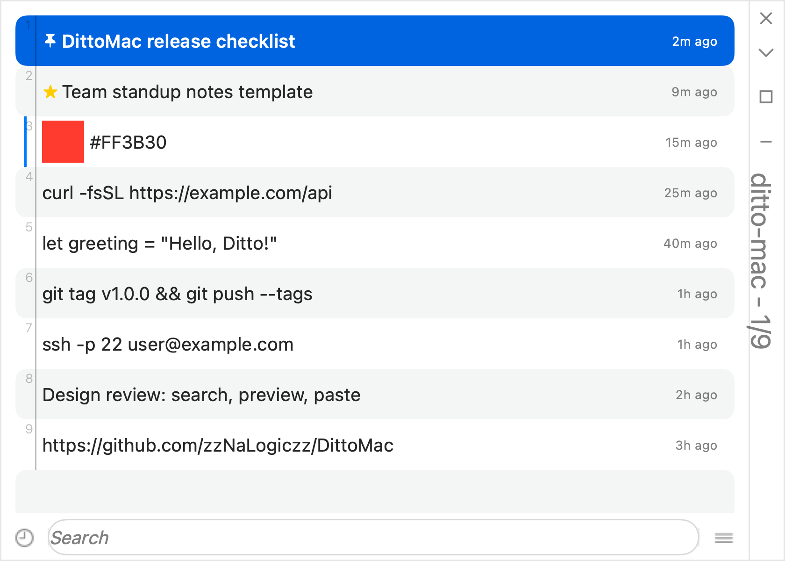

<div align="center">

# DittoMac

**The [Ditto](https://github.com/sabrogden/Ditto) clipboard manager, native on macOS.**

Every copy is saved. Press `⌘⇧V`, find it, paste it.

[](../../actions/workflows/ci.yml)
[](LICENSE)


English · [简体中文](README.zh-CN.md)

<a href="screenshots/panel-en.png"></a>

<sub>Rendered from the native app at 3× resolution with demo data. Click to view full size.</sub>

</div>

## Why DittoMac

If you have used Ditto on Windows, you know how it works: a searchable history of everything you
copy, one hotkey away, with keyboard-first paste. DittoMac brings that same workflow to the Mac,
with the same shortcuts, the same menus and the same behavior, as a native app.

- **Lightweight and native.** Swift and AppKit, with no Electron, no web view and no third-party dependencies.
- **Keyboard first.** Search, preview and paste without touching the mouse.
- **Private by default.** History stays in a local SQLite database. Nothing is sent over the network, and entries copied from password managers are never recorded.

## Install

Download the latest DMG from [Releases](../../releases), open it, and drag `DittoMac.app` into
`Applications`.

On first launch, grant **Accessibility** permission
(System Settings → Privacy & Security → Accessibility). DittoMac needs it to send ⌘V to the
app you are pasting into. Without it, selecting an entry still copies it to the clipboard, and
you can paste with ⌘V yourself.

> **About Gatekeeper.** DittoMac is signed with a self-signed certificate and is not notarized.
> If macOS blocks the first launch, right-click the app and choose **Open**, or use
> *Open Anyway* in Privacy & Security.

**Requirements:** macOS 13 Ventura or later, Apple Silicon (arm64).

## Usage

Press **`⌘⇧V`** (rebindable in Settings) to open the Quick Paste window at your cursor. Start
typing to search, use the arrow keys to pick an entry, then press `Enter`. DittoMac pastes it into
the app you were using and restores your previous clipboard.

### Keyboard shortcuts

| Key | Action |
|---|---|
| `Enter` / double-click | Paste |
| `⇧Enter` | Paste as plain text |
| `⌘1` … `⌘0` | Paste entries 1–10 directly |
| `⌥Enter` | Entry properties |
| `F3` | Show full content |
| `N` / `P` | Next / previous entry |
| `⌘C` / `⌘A` | Copy selected / select all |
| `⌥C` | Clear search filter |
| `⌃Space` | Keep window on top |
| `Delete` | Delete entry |
| `Esc` | Close tooltip, then clear filter, then close window |
| `⇧Esc` | Close immediately |
| *any text* | Jump to search |

### Search

Find-as-you-type, with a small query syntax:

| Query | Matches |
|---|---|
| `foo bar` | Entries containing both terms |
| `foo OR bar` | Either term |
| `foo NOT bar` | `foo` but not `bar` |
| `"foo bar"` | The exact phrase |
| `foo*` | Wildcard |

### Special Paste

Transform content as you paste it: change case, trim whitespace, convert path styles, strip to
ASCII, change line endings, add a timestamp, make a slug, insert a new GUID, paste as an image, and more.

## Features

- **Every format, kept together.** Text, rich text, HTML, images and files are stored as one
  entry and pasted back exactly as copied.
- **No duplicates.** Copying something you already have moves it to the top.
- **Previews.** Hover an entry to see its full content, image thumbnails, and color swatches for
  values like `#FF8800`.
- **Multi-select paste.** Combine several entries into one paste, or merge images side by side
  or stacked.
- **Organize.** Pin entries, mark them never-delete, reorder them, or filter by a selected entry.
- **Retention.** Trim history by count or age. Pinned and never-delete entries are always kept.
- **Resilient storage.** History survives restarts. A corrupted database is detected, backed up
  and rebuilt automatically.
- **Backup and transfer.** Back up and restore the database; import and export text entries;
  export images.
- **Menu bar control.** Pause recording from the tray icon, and launch at login.
- **English and 简体中文**, switchable in Settings without a restart.

## Build from source

You only need the Xcode Command Line Tools; the full Xcode app is not required.

```zsh
git clone https://github.com/zzNaLogiczz/DittoMac.git && cd DittoMac
swift build -c release
./scripts/make-app.sh      # produces DittoMac.app
./scripts/make-dmg.sh      # produces DittoMac-vX.Y.Z-arm64.dmg
./scripts/run-tests.sh     # runs the test suite
./scripts/make-screenshots.sh # regenerates both 3× README screenshots (macOS desktop)
```

Pushing a tag such as `v1.2.3` triggers GitHub Actions to test, build and attach the DMG and
tarball to a Release.

## Relationship to Ditto

DittoMac is an independent Swift implementation that follows the behavior of
[Ditto](https://github.com/sabrogden/Ditto) by Scott Brogden and contributors. It shares no code
with the original. The app icon is a macOS redesign based on the original Ditto icon. This project is not affiliated
with or endorsed by the Ditto project.

### Not supported yet

LAN sync and friends, group tree, per-entry hotkeys, clip editor, QR codes, scripting.

## License

[GPL-3.0](LICENSE), the same as Ditto.
