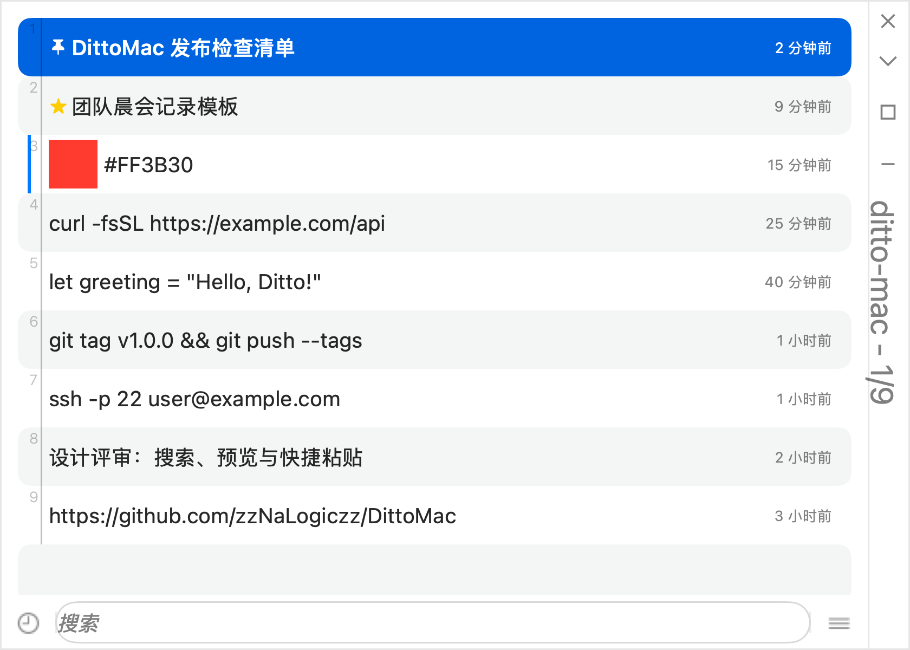

<div align="center">

# DittoMac

**[Ditto](https://github.com/sabrogden/Ditto) 剪贴板管理器的 macOS 原生版本。**

复制过的内容都不会丢。按下 `⌘⇧V`,找到它,粘贴。

[](../../actions/workflows/ci.yml)
[](LICENSE)


[English](README.md) · 简体中文



</div>

## 为什么用 DittoMac

用过 Windows 上的 Ditto 就知道它怎么工作:你复制的所有内容都有一份可搜索的历史,一个热键唤出,
全程键盘操作。DittoMac 把这套工作流搬到了 Mac,快捷键、菜单和行为都与 Ditto 一致,并且是原生应用。

- **轻量原生**:Swift + AppKit,没有 Electron、没有 WebView、没有第三方依赖
- **键盘优先**:搜索、预览、粘贴都不用碰鼠标
- **默认私密**:历史记录只存在本地 SQLite 数据库,不联网;来自密码管理器的内容不会被记录

## 安装

到 [Releases](../../releases) 下载最新的 DMG,打开后把 `DittoMac.app` 拖进 `Applications`。

首次启动需要授予**辅助功能**权限(系统设置 → 隐私与安全性 → 辅助功能),
DittoMac 要用它向目标应用发送 ⌘V。未授权时,选中条目仍会写入剪贴板,你可以手动 ⌘V 粘贴。

> **关于 Gatekeeper**:DittoMac 使用自签名证书,未经 Apple 公证。如果首次启动被拦截,
> 请右键应用选择"打开",或在"隐私与安全性"中点击"仍要打开"。

**系统要求**:macOS 13 Ventura 及以上,Apple Silicon (arm64)。

## 使用

按 **`⌘⇧V`**(可在设置中修改)在光标处唤出快速粘贴窗口。直接输入即可搜索,方向键选择条目,回车粘贴。
DittoMac 会把内容粘贴到你之前所在的应用,并恢复原来的剪贴板。

### 快捷键

| 按键 | 功能 |
|---|---|
| `Enter` / 双击 | 粘贴 |
| `⇧Enter` | 以纯文本粘贴 |
| `⌘1` … `⌘0` | 直接粘贴第 1–10 条 |
| `⌥Enter` | 条目属性 |
| `F3` | 查看完整内容 |
| `N` / `P` | 下一条 / 上一条 |
| `⌘C` / `⌘A` | 复制所选 / 全选 |
| `⌥C` | 清除搜索过滤 |
| `⌃Space` | 窗口置顶 |
| `Delete` | 删除条目 |
| `Esc` | 依次:关闭浮窗 → 清除过滤 → 关闭窗口 |
| `⇧Esc` | 直接关闭 |
| *任意字符* | 跳转到搜索框 |

### 搜索

输入即搜,支持简单的查询语法:

| 查询 | 匹配 |
|---|---|
| `foo bar` | 同时包含两个词 |
| `foo OR bar` | 包含任意一个词 |
| `foo NOT bar` | 包含 `foo` 但不含 `bar` |
| `"foo bar"` | 精确短语 |
| `foo*` | 通配符 |

### 特殊粘贴

粘贴时同步转换内容:大小写、去除首尾空白、路径风格转换、仅保留 ASCII、换行符转换、附加时间戳、
生成 slug、插入新 GUID、贴为图片等。

## 功能

- **多格式并存**:文本、富文本、HTML、图片、文件作为同一条记录保存,粘贴时原样还原
- **不产生重复**:再次复制已有内容时,旧记录会被移到最前
- **预览**:悬停条目查看完整内容;图片显示缩略图;`#FF8800` 这类颜色值显示色块
- **多选粘贴**:把多条记录合并粘贴,或把多张图片横向 / 纵向拼接
- **整理**:置顶、标记永不删除、调整顺序、以所选条目为条件过滤
- **清理策略**:按条数或天数清理历史,置顶和永不删除的条目始终保留
- **存储可靠**:重启后历史仍在;数据库损坏时自动检测、备份并重建
- **备份与迁移**:数据库备份 / 恢复,文本条目导入 / 导出,图片导出
- **菜单栏控制**:在托盘图标中暂停记录;支持开机自启
- **English / 简体中文**,在设置中即时切换,无需重启

## 从源码构建

只需 Xcode Command Line Tools,不需要完整的 Xcode。

```zsh
git clone https://github.com/zzNaLogiczz/DittoMac.git && cd DittoMac
swift build -c release
./scripts/make-app.sh      # 生成 DittoMac.app
./scripts/make-dmg.sh      # 生成 DittoMac-vX.Y.Z-arm64.dmg
./scripts/run-tests.sh     # 运行测试
```

推送 `v1.2.3` 这样的 tag 会触发 GitHub Actions 自动测试、构建,并把 DMG 和 tar.gz 附加到 Release。

## 与 Ditto 的关系

DittoMac 是独立的 Swift 实现,行为上遵循 Scott Brogden 及贡献者开发的
[Ditto](https://github.com/sabrogden/Ditto),与原项目不共享代码。应用图标基于原版 Ditto 标识重新设计为 macOS 版本。
本项目与 Ditto 项目没有隶属关系,也未获其背书。

### 暂不支持

局域网同步与好友、分组树、条目级热键、条目编辑器、二维码、脚本。

## 许可证

[GPL-3.0](LICENSE),与 Ditto 一致。
